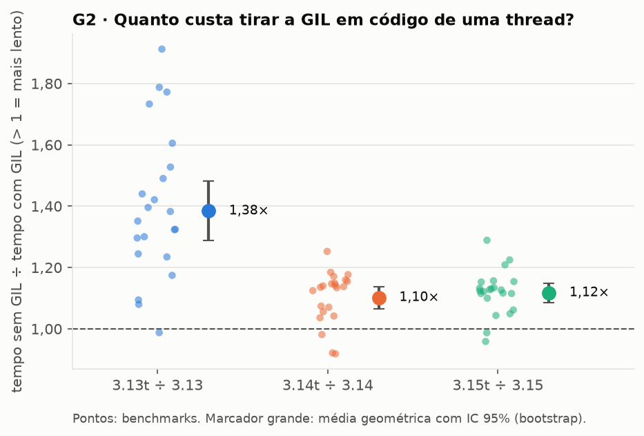
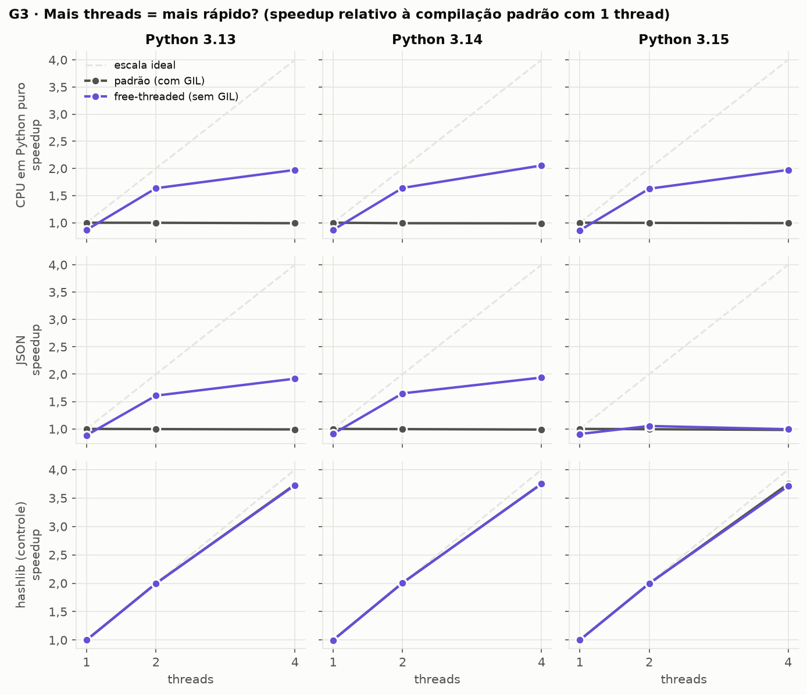

<!-- ESTE É O MODELO DO README. Edite aqui, não no README.md (ele é gerado por `python build.py`).
     Os trechos entre chaves duplas são preenchidos automaticamente com tabelas e gráficos. -->

# CPython com e sem GIL: as versões novas cumprem o que prometem?

Laboratório 05 · Experimento em software real · Laboratório de Experimentação de Software · Engenharia de Software · PUC Minas · 2026/2

- **Repositório:** https://github.com/thiagobranc0/lab05-python-gil
- **GitHub Projects:** https://github.com/users/thiagobranc0/projects/2
- **Como o experimento roda:** [`bench/DESENHO.md`](bench/DESENHO.md) · **Guia de defesa:** [`docs/DEFESA.md`](docs/DEFESA.md)

> Este README é gerado por código a cada coleta validada (`python build.py`). A coleta, a validação e a
> geração rodam sozinhas no GitHub Actions ([workflow](.github/workflows/benchmark.yml)); não há etapa manual.

## 1. O software

O **CPython** é a implementação de referência da linguagem Python, mantida pela Python Software Foundation.

| Critério | Evidência | Fonte |
|---|---|---|
| Real | _a preencher (#2)_ | |
| Em operação | Versões mantidas em 20/11/2026: 3.15 e 3.14 (bugfix), 3.13 (security) | [devguide.python.org/versions](https://devguide.python.org/versions/) (acesso em 20/11/2026) |
| Alto impacto | _a preencher (#2)_ | |

## 2. Pergunta, GQM e hipóteses

**Pergunta:** As versões recentes do CPython e a compilação sem GIL (free-threaded) entregam os ganhos de
desempenho anunciados, e a que custo para o código de uma thread só?

| Questão | Métrica | H₀ | H₁ |
|---|---|---|---|
| Q1 · Cada versão nova é mais rápida em código de uma thread? | tempo por benchmark (pyperformance); speedup | o tempo não muda entre versões | o tempo muda entre versões |
| Q2 · Quanto custa tirar a GIL em código de uma thread? | razão de tempo free-threaded ÷ padrão | o tempo é igual com e sem GIL | o tempo é diferente sem GIL |
| Q3 · Sem GIL, mais threads deixam o código mais rápido? | speedup com 1, 2 e 4 threads | não há interação compilação × threads | há interação compilação × threads |
| Q4 · Quanto de memória a mais o free-threaded usa? | pico de RSS | (descritiva) | (descritiva) |

_Objetivo GQM no template de Basili, entidades, atributos e escalas: a preencher (#3)._

## 3. Desenho em uma frase

Experimento controlado, fatorial e em blocos: **6 interpretadores** (3.13, 3.14 e 3.15, cada um com e sem
GIL) rodam os mesmos benchmarks em cada **runner do GitHub Actions** (um bloco), em ordem sorteada;
vários runners em paralelo dão as réplicas. Detalhes em [`bench/DESENHO.md`](bench/DESENHO.md).

## 4. A execução analisada

> ⚠️ Resultados da execução **piloto**: servem para testar o pipeline e calibrar o desenho, não como resultado do estudo.

|  |  |
|---|---|
| Execução | `20261120-1758_piloto_44788346764` |
| Modo | `piloto` |
| Blocos (runners) | 2 |
| CPUs | AMD EPYC 9V74 80-Core Processor (2 blocos) |
| vCPUs por runner | 4 |
| Interpretadores | 3.13 = 3.13.18; 3.13t = 3.13.18; 3.14 = 3.14.10; 3.14t = 3.14.10; 3.15 = 3.15.2; 3.15t = 3.15.2 |
| Início (UTC) | 2026-11-20T17:58:47+00:00 |
| Duração dos blocos | 21–21 min |
| Validação automática | ✅ OK · [relatório](data/processed/20261120-1758_piloto_44788346764/VALIDACAO.md) · 0 aviso(s) |

## 5. Resultados

### Q1 · Cada versão nova é mais rápida? (uma thread)

| Comparação | Speedup (média geométrica) | IC 95% | Benchmarks mais rápidos |
|---|---|---|---|
| 3.14 × 3.13 | 1,125× | 1,071 – 1,187 | 20 de 22 |
| 3.15 × 3.13 | 1,166× | 1,113 – 1,226 | 20 de 22 |

Speedup por benchmark

| Benchmark | 3.14 ÷ 3.13 | 3.15 ÷ 3.13 |
|---|---|---|
| chaos | 1,133 | 1,179 |
| comprehensions | 1,060 | 1,133 |
| coroutines | 1,059 | 1,088 |
| deepcopy | 1,410 | 1,567 |
| deepcopy_memo | 1,381 | 1,346 |
| deepcopy_reduce | 1,243 | 1,306 |
| deltablue | 1,221 | 1,174 |
| fannkuch | 1,009 | 1,059 |
| float | 1,114 | 1,119 |
| generators | 0,985 | 0,999 |
| go | 1,466 | 1,482 |
| hexiom | 1,278 | 1,296 |
| json_dumps | 0,987 | 1,123 |
| json_loads | 1,019 | 1,055 |
| nbody | 1,065 | 1,161 |
| nqueens | 1,005 | 1,071 |
| pickle_pure_python | 1,009 | 0,997 |
| pidigits | 1,008 | 1,006 |
| raytrace | 1,042 | 1,075 |
| regex_compile | 1,151 | 1,161 |
| richards | 1,269 | 1,236 |
| spectral_norm | 1,034 | 1,210 |

### Q2 · Quanto custa tirar a GIL? (uma thread)

| Comparação | Razão de tempo (média geométrica) | IC 95% | Custo | Benchmarks mais lentos sem GIL |
|---|---|---|---|---|
| 3.13t ÷ 3.13 | 1,384× | 1,288 – 1,482 | 38,4 % | 21 de 22 |
| 3.14t ÷ 3.14 | 1,102× | 1,064 – 1,137 | 10,2 % | 19 de 22 |
| 3.15t ÷ 3.15 | 1,117× | 1,086 – 1,148 | 11,7 % | 20 de 22 |

### Q3 · Sem GIL, mais threads = mais rápido?

Speedup com 4 threads, relativo à compilação padrão com 1 thread da mesma versão:

| Carga | Versão | Padrão (com GIL) | Free-threaded (sem GIL) |
|---|---|---|---|
| CPU em Python puro | 3.13 | 0,99× | 1,97× |
| CPU em Python puro | 3.14 | 0,99× | 2,05× |
| CPU em Python puro | 3.15 | 0,99× | 1,97× |
| hashlib (controle) | 3.13 | 3,74× | 3,73× |
| hashlib (controle) | 3.14 | 3,75× | 3,75× |
| hashlib (controle) | 3.15 | 3,75× | 3,71× |
| JSON | 3.13 | 0,99× | 1,92× |
| JSON | 3.14 | 0,99× | 1,94× |
| JSON | 3.15 | 0,98× | 0,99× |

ANOVA fatorial sobre log(tempo), uma por carga (modelo: compilação × threads + versão + bloco):

| Carga | Efeito | F | p | η² parcial |
|---|---|---|---|---|
| CPU em Python puro | compilacao | 5.397,7 | < 0,001 | 0,982 |
| CPU em Python puro | threads | 2.837,1 | < 0,001 | 0,983 |
| CPU em Python puro | compilacao × threads | 2.999,6 | < 0,001 | 0,984 |
| hashlib (controle) | compilacao | 0,1 | 0,775 | 0,001 |
| hashlib (controle) | threads | 23.804,9 | < 0,001 | 0,998 |
| hashlib (controle) | compilacao × threads | 0,5 | 0,628 | 0,009 |
| JSON | compilacao | 81,0 | < 0,001 | 0,450 |
| JSON | threads | 41,3 | < 0,001 | 0,455 |
| JSON | compilacao × threads | 45,1 | < 0,001 | 0,477 |

### Q4 · Memória

| Carga | Threads | Pico de RSS padrão (MiB) | Pico de RSS sem GIL (MiB) | Razão (média geométrica) |
|---|---|---|---|---|
| CPU em Python puro | 1 | 34,1 | 36,8 | 1,07× |
| CPU em Python puro | 2 | 34,1 | 36,9 | 1,08× |
| CPU em Python puro | 4 | 34,1 | 37,5 | 1,09× |
| hashlib (controle) | 1 | 34,1 | 37,0 | 1,08× |
| hashlib (controle) | 2 | 34,1 | 37,2 | 1,08× |
| hashlib (controle) | 4 | 34,1 | 37,6 | 1,09× |
| JSON | 1 | 34,1 | 37,0 | 1,08× |
| JSON | 2 | 34,1 | 37,4 | 1,08× |
| JSON | 4 | 34,1 | 38,0 | 1,09× |

### Testes de hipótese

| Q | Teste | n | Estatística | p | p (Holm) | Tamanho do efeito |
|---|---|---|---|---|---|---|
| Q1 | Wilcoxon pareado: tempo 3.14 × 3.13 (padrão) | 22 | W = 11,0 | < 0,001 | < 0,001 | rank-biserial = -0,91 |
| Q1 | Wilcoxon pareado: tempo 3.15 × 3.14 (padrão) | 22 | W = 36,0 | 0,002 | 0,004 | rank-biserial = -0,72 |
| Q1 | Wilcoxon pareado: tempo 3.15 × 3.13 (padrão) | 22 | W = 3,0 | < 0,001 | < 0,001 | rank-biserial = -0,98 |
| Q2 | Wilcoxon pareado: tempo 3.13t × 3.13 (1 thread) | 22 | W = 1,0 | < 0,001 | < 0,001 | rank-biserial = 0,99 |
| Q2 | Wilcoxon pareado: tempo 3.14t × 3.14 (1 thread) | 22 | W = 16,0 | < 0,001 | < 0,001 | rank-biserial = 0,87 |
| Q2 | Wilcoxon pareado: tempo 3.15t × 3.15 (1 thread) | 22 | W = 3,0 | < 0,001 | < 0,001 | rank-biserial = 0,98 |
| Q3 | ANOVA, interação compilação × threads: cpu_puro | 108 | F = 2.999,6 | < 0,001 | < 0,001 | η²p = 0,984 |
| Q3 | ANOVA, interação compilação × threads: hash_controle | 108 | F = 0,5 | 0,628 | 0,628 | η²p = 0,009 |
| Q3 | ANOVA, interação compilação × threads: json | 108 | F = 45,1 | < 0,001 | < 0,001 | η²p = 0,477 |

### Estabilidade das medições

## 6. Ameaças à validade

_A preencher (#17)._

## 7. Impacto

_A preencher (#18)._

## 8. Histórico de execuções

| Execução | Modo | Blocos | Validação | Avisos |  |
|---|---|---|---|---|---|
| `20261120-1758_piloto_44788346764` | piloto | 2 | ✅ | 0 | [relatório](data/processed/20261120-1758_piloto_44788346764/VALIDACAO.md) |

## 9. Reproduzir

- **Coleta:** aba *Actions* → *benchmark* → *Run workflow* (modo `teste`, `piloto` ou `completo`; nº de blocos).
- **Análise local:** `pip install -r requirements.txt && python build.py`
