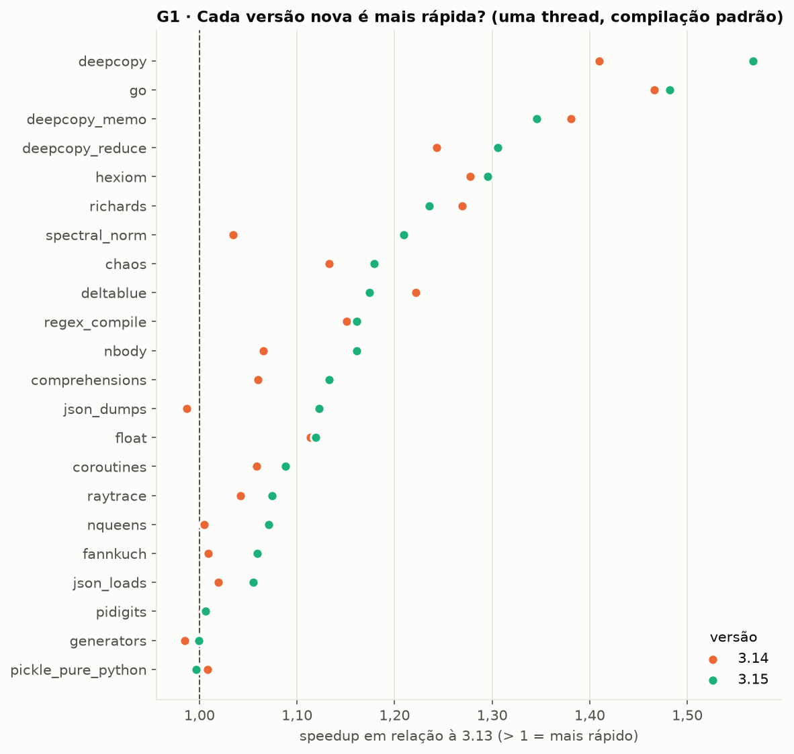
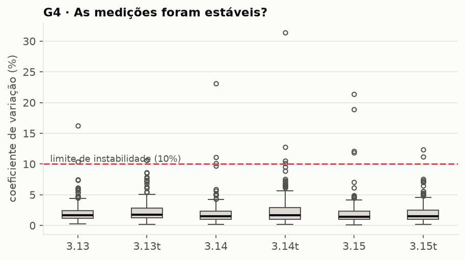

<!-- ESTE É O MODELO DO README. Edite aqui, não no README.md (ele é gerado por `python build.py`).
     Os trechos entre chaves duplas são preenchidos automaticamente com tabelas e gráficos. -->

# CPython com e sem GIL: as versões novas cumprem o que prometem?

Laboratório 05 · Experimento em software real · Laboratório de Experimentação de Software · Engenharia de Software · PUC Minas · 2026/2

- **Repositório:** https://github.com/thiagobranc0/lab05-python-gil
- **GitHub Projects:** https://github.com/users/thiagobranc0/projects/2
- **Como o experimento roda:** [`bench/DESENHO.md`](bench/DESENHO.md) · **Guia de defesa:** [`docs/DEFESA.md`](docs/DEFESA.md)

> Este README é gerado por código a cada coleta validada (`python build.py`). A coleta, a validação e a
> geração rodam sozinhas no GitHub Actions ([workflow](.github/workflows/benchmark.yml)); não há etapa manual.

## 1. O software

O **CPython** é a implementação de referência da linguagem Python, mantida pela Python Software Foundation.

## 1. O software

O **CPython** é a implementação de referência da linguagem Python, mantida pela Python Software Foundation.

| Critério | Evidência | Fonte |
|---|---|---|
| Real | O glossário oficial define o CPython como "a implementação canônica da linguagem Python, como distribuída em python.org"; é a base da qual saem as versões 3.13, 3.14 e 3.15 analisadas aqui. A PEP 703 (GIL opcional) e a PEP 779 (free-threading com suporte oficial) são mudanças feitas no próprio CPython e aceitas pelo Steering Council. | [Glossário da documentação do Python](https://docs.python.org/3/glossary.html) · [PEP 703](https://peps.python.org/pep-0703/) · [PEP 779](https://peps.python.org/pep-0779/) (acesso em 21/11/2026) |
| Em operação | Versões mantidas em 21/11/2026: **3.15** e **3.14** (bugfix) e **3.13** (security); fim de suporte previsto para 10/2031, 10/2030 e 10/2029. Última versão de cada série: 3.15.2, 3.14.10 e 3.13.18, todas lançadas em 25/10/2026 (3.15.0 saiu em 09/10/2026; 3.14.0 em 07/10/2025; 3.13.0 em 07/10/2024). | [devguide.python.org/versions](https://devguide.python.org/versions/) · [python.org/downloads](https://www.python.org/downloads/) (acesso em 21/11/2026) |
| Alto impacto · popularidade | **TIOBE, novembro/2026:** Python em 1º lugar, com 20,86% (C: 11,48%; Java: 8,89%). **Stack Overflow Developer Survey 2026** (mais de 30 mil respondentes): Python usado por 58%, empatado com SQL e HTML/CSS; JavaScript lidera com 62%. | [TIOBE Index, nov/2026 (TechRepublic, 09/11/2026)](https://www.techrepublic.com/article/news-tiobe-november-2026-java-overtakes-cpp/) · [Stack Overflow, resultados de 2026](https://stackoverflow.blog/2026/10/06/the-results-of-the-2026-developer-survey-are-here/) (acesso em 21/11/2026) |
| Alto impacto · distribuição | **PyPI:** 2,56 trilhões de requisições e 1,92 EB transferidos em 2025; mais de 130 mil projetos novos e 3,9 milhões de arquivos publicados no ano. **Exemplo de pacote:** o `pip` teve 628.607.265 downloads nos 30 dias até 02/11/2026. <!-- PENDENTE (#2): total de downloads do PyPI por mês e participação por versão do Python em pypistats.org (não acessível na sessão do Claude); preencher à mão com a data de acesso. --> | [PyPI in 2025: A Year in Review](https://blog.pypi.org/posts/2025-12-31-pypi-2025-in-review) · [pepy.tech/projects/pip](https://pepy.tech/projects/pip) (acesso em 21/11/2026) |
| Alto impacto · nuvem | **AWS Lambda:** runtimes `python3.13`, `python3.14` e `python3.15` listados, com depreciação prevista para 30/06/2029. **Google Cloud Functions:** `python313` (depreciação 10/10/2029) e `python314` (10/10/2030); 3.15 em preview. **Azure Functions:** 3.13 e 3.14 em GA (fim de suporte previsto para 10/2029 e 04/2029); 3.15 em preview. | [AWS Lambda runtimes](https://docs.aws.amazon.com/lambda/latest/dg/lambda-runtimes.html) · [Google Cloud Functions, suporte de runtime](https://docs.cloud.google.com/functions/docs/runtime-support) · [Azure Functions, linguagens suportadas](https://learn.microsoft.com/azure/azure-functions/supported-languages) (acesso em 21/11/2026) |

### Contexto: Faster CPython e a GIL

- **Faster CPython:** projeto que busca acelerar o interpretador a cada versão (JIT, interpretador especializado). Em 2025 a equipe perdeu seu principal patrocinador e o JIT passou a ser mantido pela comunidade. [Python Insider: JIT da 3.15 de volta ao rumo](https://blog.python.org/2026/03/jit-on-track/) (acesso em 21/11/2026).
- **PEP 703 (GIL opcional):** aceita pelo Steering Council, status Final, alvo 3.13; cria a compilação free-threaded, em que a GIL deixa de existir. [PEP 703](https://peps.python.org/pep-0703/) (acesso em 21/11/2026).
- **PEP 779 (free-threading com suporte oficial):** status Final, resolvida em 16/06/2025, alvo 3.14. Define os critérios para sair de "experimental": no máximo 15 % mais lento e 20 % mais memória que a compilação com GIL, medidos pelo `pyperformance`. Tornar o free-threaded o padrão fica para uma PEP futura. [PEP 779](https://peps.python.org/pep-0779/) (acesso em 21/11/2026).

Os ganhos anunciados a cada versão e o seu confronto com a medição estão na seção "Anunciado × medido" (#15).

## 2. Pergunta, GQM e hipóteses

### 2.1 Pergunta de pesquisa e objetivo (template de Basili)

**Pergunta principal:** As versões recentes do CPython e a compilação sem GIL (free-threaded) entregam os ganhos de
desempenho anunciados, e a que custo para o código de uma thread só?

**Objetivo (GQM, template de Basili):**

> **Analisar** as versões 3.13, 3.14 e 3.15 do CPython, cada uma na compilação padrão (com GIL) e na free-threaded (sem GIL),
> **com o propósito de** avaliar (comparar versões e compilações),
> **com respeito a** desempenho (tempo de execução com uma thread e escalonamento com 1, 2 e 4 threads) e consumo de memória (pico de RSS),
> **do ponto de vista de** quem mantém ou opera aplicações Python e decide se atualiza a versão ou adota o free-threading,
> **no contexto de** runners do GitHub Actions (Linux x86-64, 4 vCPUs), com 20 benchmarks em Python puro do `pyperformance` 1.14.0 e 4 cargas próprias com threads.

### 2.2 Questões (Q) e métricas (M) do GQM

| Questão | Métricas |
|---|---|
| **Q1** · Cada versão nova é mais rápida que a anterior em código de uma thread? | **M1** tempo por benchmark (s, mediana do `pyperf` no bloco); **M2** speedup entre versões (razão de tempos) e sua média geométrica, com IC 95 % |
| **Q2** · Quanto a compilação sem GIL custa em código de uma thread? | **M3** razão de tempo free-threaded ÷ padrão, na mesma versão (overhead % = razão − 1), média geométrica com IC 95 % |
| **Q3** · Quanto a compilação sem GIL ganha em código CPU-bound com várias threads? | **M4** tempo da carga com 1, 2 e 4 threads (s); **M5** speedup com n threads (tempo com 1 thread ÷ tempo com n) e eficiência de escalonamento (speedup ÷ n) |
| **Q4** · Quanto de memória a mais a compilação sem GIL usa? | **M6** pico de RSS do processo (MiB); razão de RSS free-threaded ÷ padrão |

Metas do GQM: **G1** saber se a atualização de versão compensa (Q1); **G2** saber o preço do free-threading em código de uma thread (Q2); **G3** saber o ganho do free-threading com paralelismo (Q3); **G4** saber o custo de memória (Q4).

### 2.3 Hipóteses (H₀/H₁) e direção dos testes

Nível de significância de 0,05, com correção de Holm sobre a família de testes (Q1 a Q3).

| Questão | H₀ | H₁ | Teste e direção |
|---|---|---|---|
| Q1 | o tempo dos benchmarks é o mesmo nas duas versões (média geométrica do speedup = 1) | o tempo muda entre as versões | Wilcoxon pareado por benchmark, **bilateral**; três pares: 3.14 × 3.13, 3.15 × 3.14 e 3.15 × 3.13 |
| Q2 | o tempo é igual com e sem GIL (razão = 1) | o tempo é diferente sem GIL (razão ≠ 1) | Wilcoxon pareado por benchmark, **bilateral**; um teste por versão |
| Q3 | não há interação compilação × threads: mudar o nº de threads tem o mesmo efeito com e sem GIL | há interação compilação × threads | ANOVA fatorial sobre log(tempo), com bloco como fator, uma por carga; o teste F é **não direcional** por natureza |
| Q4 | (descritiva) | (descritiva) | sem teste: reportamos a razão de RSS e a comparamos com o limite de 20 % usado nos critérios da PEP 779 |

**Por que bilateral (Q1 e Q2).** (i) As hipóteses unilaterais seguiriam os anúncios ("mais rápido", "mais lento sem GIL"),
mas o estudo existe justamente para conferir os anúncios; um teste unilateral não consegue detectar o resultado
contrário (uma regressão de desempenho numa versão nova, ou um benchmark que ganha sem GIL). (ii) O teste
bilateral é o mais conservador, e é o implementado em `src/analise.py` (`alternative="two-sided"`). (iii) A direção
não se perde: ela é lida do sinal da diferença, do IC 95 % da razão e do número de benchmarks que melhoram ou pioram. Para
Q3, a pergunta é sobre interação, e interação não tem direção no teste F; o sentido (ganho só sem GIL) é lido nos
speedups. Na Q3, a carga `hash_controle` (o `hashlib` libera a GIL) serve de controle: esperamos **não** rejeitar H₀ nela.

Regra de replicação (definida antes da replicação, em `bench/DESENHO.md`): "conclusão mantida" = mesmo lado do IC 95 % em relação a 1 (Q1, Q2) e mesma decisão com limiar de 1,2× (Q3).

### 2.4 Variáveis

| Tipo | Variável | Níveis / medida |
|---|---|---|
| Independente | Versão do CPython | 3.13.18, 3.14.10, 3.15.2 |
| Independente | Compilação | padrão (com GIL) · free-threaded (sem GIL) |
| Independente | Número de threads (cargas com threads) | 1, 2, 4 |
| Independente | Carga | 20 benchmarks do `pyperformance` (1 thread); `cpu_puro`, `json`, `json_compartilhado` e `hash_controle` (várias threads) |
| Dependente | Tempo de execução | s |
| Dependente | Speedup (e eficiência de escalonamento) | razão de tempos (e speedup ÷ n) |
| Dependente | Pico de RSS | MiB |
| Controlada | Máquina | cada runner (bloco) mede os 6 interpretadores; a comparação é sempre pareada dentro do bloco |
| Controlada | Cargas e trabalho total | mesmas cargas e mesmo trabalho em todos os interpretadores (conferido por `checksum`) |
| Controlada | Versões do `pyperformance`/`pyperf`, do `uv` e dos interpretadores | fixadas (1.14.0; `uv` 0.13.9; versões esperadas conferidas na validação) |
| Controlada | Ordem de execução | sorteada em cada bloco, com semente fixa (`SEMENTE_BASE` + nº do bloco) |
| Não controlada | Hardware dos runners (CPU, vizinhos) | absorvida pelo fator bloco; vira ameaça à validade (seção 6) |

### 2.5 Entidade, atributo, tipo de medida e escala

| Métrica | Entidade | Atributo | Medida | Escala | Estatísticas permitidas |
|---|---|---|---|---|---|
| M1 tempo por benchmark | produto (o interpretador em execução) | externo (desempenho, depende do ambiente) | direta | razão | média, mediana, razão, média geométrica |
| M2 speedup entre versões | produto | externo | derivada (razão de M1) | razão | média geométrica, IC por bootstrap; **não** média aritmética de razões |
| M3 overhead do free-threaded | produto | externo | derivada (razão de M1; overhead % = razão − 1) | razão | média geométrica, IC por bootstrap |
| M4 tempo com n threads | produto | externo | direta (`time.perf_counter`, da largada em barreira ao fim da última thread) | razão | média, mediana, razão |
| M5 speedup e eficiência | produto | externo | derivada (M4 com 1 thread ÷ M4 com n; eficiência = speedup ÷ n) | razão (eficiência ideal = 1) | média geométrica |
| M6 pico de RSS | produto (processo) e recurso (memória) | externo | direta (`ru_maxrss`) | razão | média, mediana, razão |

A versão do interpretador é de escala **ordinal** e o nº de threads, de **razão** tratado como fator. A média geométrica é a estatística
adequada para razões: a média aritmética de speedups é enviesada (um 2× e um 0,5× "dão" 1,25× em vez de 1×).

### 2.6 Armadilhas de medição (Goodhart, Campbell, McNamara)

| Armadilha | Como aparece neste estudo | O que fazemos |
|---|---|---|
| **Lei de Goodhart** ("quando uma medida vira meta, deixa de ser boa medida") | O `pyperformance` é a suíte que a equipe do Faster CPython usa para guiar e anunciar otimizações; a média geométrica virou o "número de manchete". Ganhos nela podem não valer para o seu código. | Não usar a média geométrica sozinha: mostrar a distribuição por benchmark (G1), o IC 95 % e quantos benchmarks melhoram; incluir cargas próprias fora da suíte. |
| **Lei de Campbell** (um indicador usado para decidir é pressionado e se corrompe) | Um benchmark pode ser ajustado para o que se mede. | Suíte oficial com versão fixada; cargas próprias com propósito declarado e `hash_controle` como controle do instrumento. |
| **Falácia de McNamara** (medir só o que é fácil medir) | Medimos tempo e RSS; ficam de fora compatibilidade com bibliotecas, estabilidade e custo de migração. Usar só Python puro exclui o código com extensões em C, que é a maior parte dos projetos reais. | Declarar que as conclusões são sobre desempenho em Python puro, nestes runners; não afirmar "vale a pena migrar" em geral. |
| Seleção de benchmarks | Os 20 benchmarks foram escolhidos por critério (Python puro, sem extensão de terceiros), e quem otimiza o interpretador também escolhe os que importam. | Critério de inclusão explícito em `bench/config.py`; exclusões registradas com motivo. |
## 3. Desenho em uma frase

Experimento controlado, fatorial e em blocos: **6 interpretadores** (3.13, 3.14 e 3.15, cada um com e sem
GIL) rodam os mesmos benchmarks em cada **runner do GitHub Actions** (um bloco), em ordem sorteada;
vários runners em paralelo dão as réplicas. Detalhes em [`bench/DESENHO.md`](bench/DESENHO.md).

## 4. A execução analisada

|  |  |
|---|---|
| Execução | `20261120-2001_completo_44807518024` |
| Modo | `completo` |
| Blocos (runners) | 10 |
| CPUs | AMD EPYC 7763 64-Core Processor (5 blocos); AMD EPYC 9V74 80-Core Processor (4 blocos); AMD EPYC 9V45 96-Core Processor (1 bloco) |
| vCPUs por runner | 4 |
| Núcleos físicos × threads por núcleo | 2 × 2 |
| Interpretadores | 3.13 = 3.13.18; 3.13t = 3.13.18; 3.14 = 3.14.10; 3.14t = 3.14.10; 3.15 = 3.15.2; 3.15t = 3.15.2 |
| Início (UTC) | 2026-11-20T20:01:42+00:00 |
| Duração dos blocos | 46–60 min |
| Validação automática | ✅ OK · [relatório](data/processed/20261120-2001_completo_44807518024/VALIDACAO.md) · 1 aviso(s) |

## 5. Resultados

### Q1 · Cada versão nova é mais rápida? (uma thread)

| Comparação | Speedup (média geométrica) | IC 95% | Benchmarks mais rápidos |
|---|---|---|---|
| 3.14 × 3.13 | 1,163× | 1,107 – 1,227 | 21 de 22 |
| 3.15 × 3.13 | 1,201× | 1,146 – 1,264 | 22 de 22 |

Speedup por benchmark

| Benchmark | 3.14 ÷ 3.13 | 3.15 ÷ 3.13 |
|---|---|---|
| chaos | 1,158 | 1,179 |
| comprehensions | 1,092 | 1,156 |
| coroutines | 1,048 | 1,105 |
| deepcopy | 1,492 | 1,621 |
| deepcopy_memo | 1,488 | 1,436 |
| deepcopy_reduce | 1,284 | 1,348 |
| deltablue | 1,270 | 1,244 |
| fannkuch | 1,067 | 1,111 |
| float | 1,157 | 1,154 |
| generators | 1,117 | 1,138 |
| go | 1,521 | 1,547 |
| hexiom | 1,272 | 1,281 |
| json_dumps | 0,997 | 1,136 |
| json_loads | 1,037 | 1,062 |
| nbody | 1,140 | 1,190 |
| nqueens | 1,037 | 1,106 |
| pickle_pure_python | 1,063 | 1,060 |
| pidigits | 1,004 | 1,010 |
| raytrace | 1,093 | 1,135 |
| regex_compile | 1,113 | 1,121 |
| richards | 1,261 | 1,240 |
| spectral_norm | 1,084 | 1,239 |

### Q2 · Quanto custa tirar a GIL? (uma thread)

| Comparação | Razão de tempo (média geométrica) | IC 95% | Custo | Benchmarks mais lentos sem GIL |
|---|---|---|---|---|
| 3.13t ÷ 3.13 | 1,334× | 1,247 – 1,424 | 33,4 % | 21 de 22 |
| 3.14t ÷ 3.14 | 1,105× | 1,067 – 1,140 | 10,5 % | 19 de 22 |
| 3.15t ÷ 3.15 | 1,114× | 1,084 – 1,144 | 11,4 % | 20 de 22 |

### Q3 · Sem GIL, mais threads = mais rápido?

Speedup com 4 threads, relativo à compilação padrão com 1 thread da mesma versão:

| Carga | Versão | Padrão (com GIL) | Free-threaded (sem GIL) |
|---|---|---|---|
| CPU em Python puro | 3.13 | 0,98× | 2,03× |
| CPU em Python puro | 3.14 | 0,98× | 2,06× |
| CPU em Python puro | 3.15 | 0,99× | 1,95× |
| hashlib (controle) | 3.13 | 3,73× | 3,72× |
| hashlib (controle) | 3.14 | 3,74× | 3,73× |
| hashlib (controle) | 3.15 | 3,74× | 3,72× |
| JSON (cópia por thread) | 3.13 | 0,98× | 1,92× |
| JSON (cópia por thread) | 3.14 | 0,98× | 1,94× |
| JSON (cópia por thread) | 3.15 | 0,98× | 1,95× |
| JSON (objeto compartilhado) | 3.13 | 0,98× | 1,83× |
| JSON (objeto compartilhado) | 3.14 | 0,98× | 1,90× |
| JSON (objeto compartilhado) | 3.15 | 0,97× | 0,96× |

ANOVA fatorial sobre log(tempo), uma por carga (modelo planejado: compilação × threads + versão + bloco). A última linha de cada carga vem de um segundo modelo, **exploratório**, com a interação tripla compilação × threads × versão: ela testa se o ganho com threads sem GIL muda entre as versões.

| Carga | Efeito | F | p | η² parcial |
|---|---|---|---|---|
| CPU em Python puro | compilação | 42.023,0 | < 0,001 | 0,959 |
| CPU em Python puro | threads | 18.161,8 | < 0,001 | 0,953 |
| CPU em Python puro | compilação × threads | 19.803,2 | < 0,001 | 0,957 |
| CPU em Python puro | compilação × threads × versão (exploratória) | 9,2 | < 0,001 | 0,020 |
| hashlib (controle) | compilação | 0,6 | 0,448 | 0,000 |
| hashlib (controle) | threads | 187.230,0 | < 0,001 | 0,995 |
| hashlib (controle) | compilação × threads | 1,0 | 0,355 | 0,001 |
| hashlib (controle) | compilação × threads × versão (exploratória) | 0,1 | 0,993 | 0,000 |
| JSON (cópia por thread) | compilação | 111.071,3 | < 0,001 | 0,984 |
| JSON (cópia por thread) | threads | 45.197,8 | < 0,001 | 0,981 |
| JSON (cópia por thread) | compilação × threads | 51.320,8 | < 0,001 | 0,983 |
| JSON (cópia por thread) | compilação × threads × versão (exploratória) | 8,4 | < 0,001 | 0,019 |
| JSON (objeto compartilhado) | compilação | 1.171,1 | < 0,001 | 0,396 |
| JSON (objeto compartilhado) | threads | 609,6 | < 0,001 | 0,406 |
| JSON (objeto compartilhado) | compilação × threads | 740,2 | < 0,001 | 0,454 |
| JSON (objeto compartilhado) | compilação × threads × versão (exploratória) | 2.472,5 | < 0,001 | 0,848 |

### Q4 · Memória

| Carga | Threads | Pico de RSS padrão (MiB) | Pico de RSS sem GIL (MiB) | Razão (média geométrica) |
|---|---|---|---|---|
| CPU em Python puro | 1 | 35,9 | 37,1 | 1,04× |
| CPU em Python puro | 2 | 36,0 | 37,2 | 1,04× |
| CPU em Python puro | 4 | 35,9 | 37,8 | 1,05× |
| hashlib (controle) | 1 | 36,0 | 37,2 | 1,04× |
| hashlib (controle) | 2 | 35,9 | 37,4 | 1,04× |
| hashlib (controle) | 4 | 35,9 | 37,8 | 1,05× |
| JSON (cópia por thread) | 1 | 35,9 | 37,1 | 1,04× |
| JSON (cópia por thread) | 2 | 35,9 | 37,5 | 1,05× |
| JSON (cópia por thread) | 4 | 35,9 | 38,1 | 1,06× |
| JSON (objeto compartilhado) | 1 | 35,9 | 37,1 | 1,04× |
| JSON (objeto compartilhado) | 2 | 35,9 | 37,5 | 1,05× |
| JSON (objeto compartilhado) | 4 | 35,9 | 38,2 | 1,06× |

### Testes de hipótese

| Q | Teste | n | Estatística | p | p (Holm) | Tamanho do efeito |
|---|---|---|---|---|---|---|
| Q1 | Wilcoxon pareado: tempo 3.14 × 3.13 (padrão) | 22 | W = 1,0 | < 0,001 | < 0,001 | rank-biserial = -0,99 |
| Q1 | Wilcoxon pareado: tempo 3.15 × 3.14 (padrão) | 22 | W = 31,0 | 0,001 | 0,003 | rank-biserial = -0,75 |
| Q1 | Wilcoxon pareado: tempo 3.15 × 3.13 (padrão) | 22 | W = 0,0 | < 0,001 | < 0,001 | rank-biserial = -1,00 |
| Q2 | Wilcoxon pareado: tempo 3.13t × 3.13 (1 thread) | 22 | W = 1,0 | < 0,001 | < 0,001 | rank-biserial = 0,99 |
| Q2 | Wilcoxon pareado: tempo 3.14t × 3.14 (1 thread) | 22 | W = 14,0 | < 0,001 | < 0,001 | rank-biserial = 0,89 |
| Q2 | Wilcoxon pareado: tempo 3.15t × 3.15 (1 thread) | 22 | W = 3,0 | < 0,001 | < 0,001 | rank-biserial = 0,98 |
| Q3 | ANOVA, interação compilação × threads: cpu_puro | 1800 | F = 19.803,2 | < 0,001 | < 0,001 | η²p = 0,957 |
| Q3 | ANOVA exploratória, interação compilação × threads × versão: cpu_puro | 1800 | F = 9,2 | < 0,001 | < 0,001 | η²p = 0,020 |
| Q3 | ANOVA, interação compilação × threads: hash_controle | 1800 | F = 1,0 | 0,355 | 0,710 | η²p = 0,001 |
| Q3 | ANOVA exploratória, interação compilação × threads × versão: hash_controle | 1800 | F = 0,1 | 0,993 | 0,993 | η²p = 0,000 |
| Q3 | ANOVA, interação compilação × threads: json | 1800 | F = 51.320,8 | < 0,001 | < 0,001 | η²p = 0,983 |
| Q3 | ANOVA exploratória, interação compilação × threads × versão: json | 1800 | F = 8,4 | < 0,001 | < 0,001 | η²p = 0,019 |
| Q3 | ANOVA, interação compilação × threads: json_compartilhado | 1800 | F = 740,2 | < 0,001 | < 0,001 | η²p = 0,454 |
| Q3 | ANOVA exploratória, interação compilação × threads × versão: json_compartilhado | 1800 | F = 2.472,5 | < 0,001 | < 0,001 | η²p = 0,848 |

### Estabilidade das medições

### Replicação

_Aguardando a replicação (#13): uma coleta completa em outro horário, comparada aqui com a principal._

## 6. Ameaças à validade

_A preencher (#17)._

## 7. Impacto

_A preencher (#18)._

## 8. Histórico de execuções

| Execução | Modo | Blocos | Validação | Avisos |  |
|---|---|---|---|---|---|
| `20261120-2001_completo_44807518024` | completo | 10 | ✅ | 1 | [relatório](data/processed/20261120-2001_completo_44807518024/VALIDACAO.md) |
| `20261120-1758_piloto_44788346764` | piloto | 2 | ✅ | 0 | [relatório](data/processed/20261120-1758_piloto_44788346764/VALIDACAO.md) |

## 9. Reproduzir

- **Coleta:** aba *Actions* → *benchmark* → *Run workflow* (modo `teste`, `piloto` ou `completo`; nº de blocos).
- **Análise local:** `pip install -r requirements.txt && python build.py`
